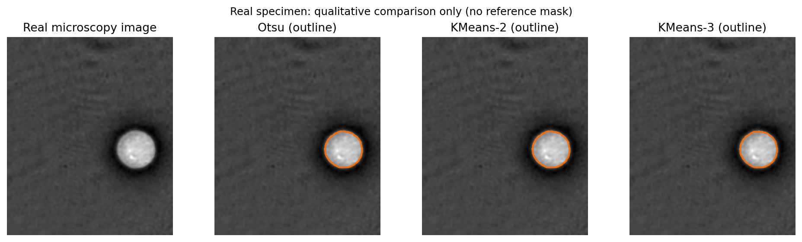
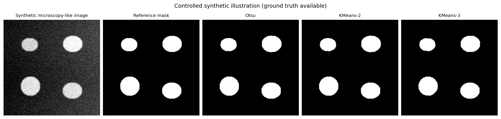
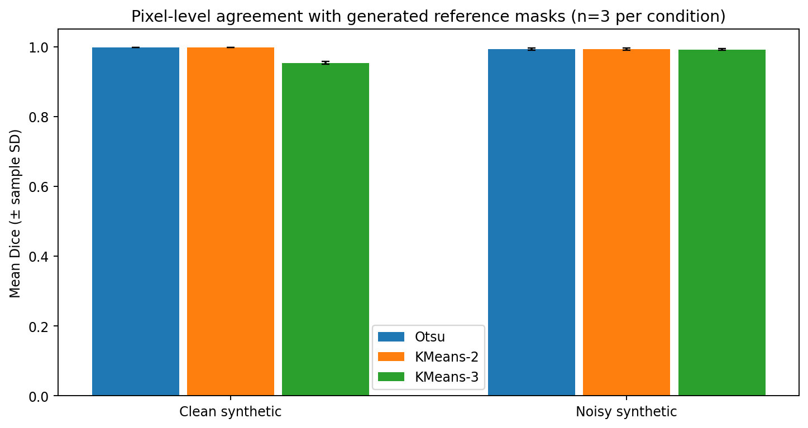

# Unsupervised Microscopy Image Segmentation Using K-Means


> **GitHub + Kaggle** — This repository contains a self-contained notebook originally prepared for Kaggle: [`notebooks/Microscopy_Segmentation_Kaggle.ipynb`](notebooks/Microscopy_Segmentation_Kaggle.ipynb). The same experiment can also be reproduced locally with `python run.py`. If your final Kaggle version has newer changes, export it and replace this file before publishing. Add the public Kaggle link once available.

**Small, reproducible introductory machine learning project.** Compare Otsu thresholding with K-Means clustering (K=2 and K=3) on a *real cell microscopy image* and *controlled synthetic cell-shaped objects with reference masks*. No GPU, no neural networks, and no training labels.

## Quick start

Python 3.10+ is recommended.

```bash
python -m venv .venv
# Windows: .venv\Scripts\activate
# macOS/Linux: source .venv/bin/activate
pip install -r requirements.txt
python run.py
```

The command regenerates all figures, quantitative CSV files, and the `results/environment.json` manifest. On Windows, `python` can be replaced with `py` if needed. For an interactive walkthrough, open `notebooks/Microscopy_Segmentation_Kaggle.ipynb` in Jupyter or Google Colab after installing the requirements. Launch Jupyter from the repository root.

## Research question

**How does unsupervised pixel-intensity clustering compare with classical Otsu thresholding for segmenting bright cell-like objects?** How do these methods respond to simple noise and illumination differences?

## Methods

- **Otsu:** Automatic binary threshold chosen from an intensity histogram.
- **KMeans-2:** Classify grayscale pixels into two clusters; the brightest cluster represents foreground.
- **KMeans-3:** Three intensity clusters, brightest cluster as foreground.
- **Fixed preprocessing:** Gaussian filter (sigma=1 pixel).
- **Fixed postprocessing:** Remove tiny objects, morphological closing, fill small holes.
- **No label leakage:** K-Means does not see reference masks, and no parameters are selected based on ground-truth scores.

## Data

**Real cell image:** `skimage.data.cell()` (quantitative phase microscopy, single cell floating in saline; 660×550 pixels, resized to 330×275 pixels). See [scikit-image dataset documentation](https://scikit-image.org/docs/stable/api/skimage.data.html#skimage.data.cell) and Müller et al. (2018), DOI: [10.1364/OE.26.010729](https://doi.org/10.1364/OE.26.010729). The image has **no provided segmentation mask**, therefore only a *visual assessment and descriptive foreground fraction* are reported.

**Synthetic data:** 6 independently generated microscopy-style scenes (3 clean and 3 noisy; 256×256 each) from random seeds 100, 101, and 102. Each scene has 4 bright ellipse-like objects with known masks, blurred boundaries, background variation and Gaussian noise. These are **not biological images**. The low-noise and high-noise versions share the same basic shapes per seed.

## Main results

These values were measured by executing the code. All scores below are **synthetic-data metrics**, not clinically or biologically validated accuracy.

| Synthetic condition | Method | Mean Dice | Mean IoU |
|---|---|---:|---:|
| Clean (n=3) | Otsu | 0.997 | 0.995 |
| Clean (n=3) | KMeans-2 | 0.997 | 0.995 |
| Clean (n=3) | KMeans-3 | 0.954 | 0.911 |
| Noisy (n=3) | Otsu | 0.993 | 0.986 |
| Noisy (n=3) | KMeans-2 | 0.993 | 0.986 |
| Noisy (n=3) | KMeans-3 | 0.992 | 0.984 |

**Interpretation:** Two-cluster K-Means and Otsu perform almost identically on the chosen simple phantoms. Three clusters do not provide consistent improvement. This study does not demonstrate that K-Means is superior to thresholding, nor validate segmentation quality on real cells.

### Figures







## Project structure

```text
microscopy-kmeans-segmentation/
├── README.md
├── REPORT.md                 # Short academic report
├── CV_ENTRY.md               # Accurate CV wording
├── requirements.txt
├── run.py                    # One-command reproduction
├── src/pipeline.py           # Data generation, segmentation, evaluation, plots
├── notebooks/Microscopy_Segmentation_Kaggle.ipynb
├── tests/test_pipeline.py
├── figures/                  # Automatically generated visual results
└── results/                  # Metrics, summary and environment manifest
```

## Evaluation and limitations

Dice, IoU, precision, and recall are computed **only** for synthetic images with reference masks. The real sample is **not** included in ground-truth accuracy metrics. Runtime is measured with the computer's wall clock and will differ between systems. This is a tiny educational benchmark: one real image, just three scenes per noise condition, simplified artificial shapes, and no expert annotations. In particular, it does not assess overlapping/touching biological cells, complex illumination, fluorescence microscopy, or photoacoustic imaging.

See [REPORT.md](REPORT.md) for equations, methods, interpretation and citations.

## Tests

```bash
python -m unittest discover -s tests -v
```

## Repository and CV integrity

This was built as an **independent academic project in 2026**, connected to the topics taught in Machine Learning (BIME740413). It should **not** be described as a confirmed final submission for a 2025 course. The datasets and measurements are explicitly labeled to prevent overstating results. See [CV_ENTRY.md](CV_ENTRY.md).

## Publishing

Follow `PUBLISHING.md` to create this as its own GitHub repository. GitHub publication requires your own authenticated account.
